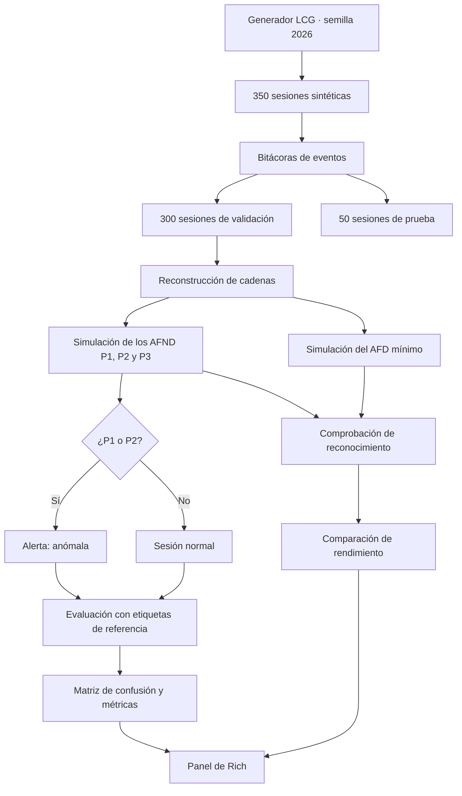

# Detección de anomalías en bitácoras de seguridad mediante autómatas finitos

<p align="center">
  <strong>Monitor académico de seguridad · AFND · AFD mínimo · Python · JFLAP</strong>
</p>

<p align="center">
  
  
  
  
</p>

## Descripción general

Este proyecto desarrolla un **monitor de detección de anomalías en bitácoras de seguridad de un servidor** mediante **autómatas finitos no deterministas (AFND)** y un **autómata finito determinista mínimo (AFD mínimo)**.

El sistema genera sesiones sintéticas reproducibles, transforma los eventos en cadenas sobre un alfabeto definido, ejecuta los autómatas, identifica patrones de interés, clasifica las sesiones y evalúa el comportamiento del monitor mediante una matriz de confusión y mediciones de rendimiento.

Los autómatas se diseñan y verifican en **JFLAP**; su lógica de transición se implementa también en **Python**. Los resultados se presentan en una terminal enriquecida con **Rich**, que permite observar tanto las métricas generales como el recorrido de los estados activos.

> **Alcance:** prototipo académico de reconocimiento formal de patrones. Los datos son sintéticos y los resultados no deben interpretarse como una validación de eficacia frente a ataques reales.

## Objetivos

- Modelar patrones de eventos de seguridad mediante lenguajes regulares y AFND.
- Unificar los lenguajes de reconocimiento y obtener un AFD mínimo mediante JFLAP.
- Implementar en Python las funciones de transición y la clasificación de sesiones.
- Generar bitácoras reproducibles y separarlas en conjuntos de validación y prueba.
- Medir verdaderos y falsos positivos y negativos, precisión, exhaustividad, exactitud y F1-score.
- Comparar el reconocimiento y tiempo de ejecución de las implementaciones AFND y AFD.
- Visualizar resultados y recorridos de estados en la terminal.

## Definición formal

El alfabeto de eventos es:

```text
Σ = {E, F, S, A, D, C, V}
```

| Símbolo | Evento |
|:---:|---|
| `E` | Inicio de sesión exitoso |
| `F` | Inicio de sesión fallido |
| `S` | Solicitud de recurso |
| `A` | Acceso autorizado |
| `D` | Acceso denegado |
| `C` | Cierre de sesión |
| `V` | Visualización de recurso público |

### Patrones supervisados

| Patrón | Expresión | Interpretación | Rol |
|:---:|:---:|---|---|
| **P1** | `FFF` | Tres inicios de sesión fallidos consecutivos | **Anomalía** |
| **P2** | `DD` | Dos denegaciones consecutivas | **Anomalía** |
| **P3** | `E` | Presencia de una autenticación exitosa | **Validación** |

Los lenguajes reconocidos son:

```text
L₁ = Σ* FFF Σ*
L₂ = Σ* DD  Σ*
L₃ = Σ* E   Σ*
```

**Regla del monitor:** una sesión se clasifica como **anómala** si se reconoce **P1 o P2**. P3 no activa una alerta por sí solo.

**Importante:** el AFD mínimo construido para la unión `L₁ ∪ L₂ ∪ L₃` puede aceptar una sesión normal si contiene `E`. Por eso **aceptación del AFD unificado** y **clasificación de anomalía** son decisiones distintas.

## Funcionamiento del sistema



### Componentes de la implementación

1. **Generación de datos.** Emplea un generador lineal congruencial (LCG) con semilla `2026` para producir sesiones reproducibles.
2. **Modelado de AFND.** Representa los estados y las funciones de transición mediante estructuras de Python; un AFND puede mantener varios estados activos por símbolo.
3. **Ejecución del AFD mínimo.** Procesa cada símbolo mediante un único estado activo.
4. **Clasificación.** Emite alertas únicamente por los patrones P1 y P2.
5. **Evaluación.** Compara las predicciones con las etiquetas del conjunto de validación, sin utilizar esas etiquetas para tomar la decisión.
6. **Trazabilidad.** Presenta paso a paso los estados activos y el resultado de aceptación o rechazo.
7. **Panel visual.** Muestra distribución de sesiones, métricas, patrones y comparación de tiempos en una terminal Rich; la distribución también se representa mediante un gráfico emergente de Matplotlib.

## Tecnologías

| Herramienta | Uso |
|---|---|
| **Python 3** | Generación de bitácoras, implementación de autómatas, evaluación y monitor |
| **pandas** | Tablas, agrupación de eventos, lectura y exportación CSV |
| **Matplotlib** | Gráfico de distribución de sesiones |
| **Rich** | Paneles, tablas y trazabilidad visual en terminal |
| **JFLAP** | Diseño, conversión, minimización y comprobación de autómatas |
| **Git y GitHub** | Versionamiento y trabajo colaborativo |

El desarrollo y las ejecuciones compartidas por el equipo se han realizado con **Python 3.13** en Windows.

## Instalación y ejecución

### 1. Clonar el repositorio

```bash
git clone https://github.com/vivinaCordova/Deteccion-anomalias-automatas-finito.git
cd Deteccion-anomalias-automatas-finito
```

### 2. Preparar el entorno virtual (recomendado)

**Windows — PowerShell**

```powershell
python -m venv .venv
.\.venv\Scripts\Activate.ps1
```

**Linux / macOS**

```bash
python3 -m venv .venv
source .venv/bin/activate
```

### 3. Instalar dependencias

```bash
python -m pip install pandas matplotlib rich
```

### 4. Ejecutar el monitor

```bash
python generador_bitacoras_servidor.py
```

Durante la ejecución, el programa genera y verifica las sesiones, exporta los CSV, simula los autómatas, calcula las métricas y muestra el panel de resultados. El gráfico de distribución se presenta en una ventana independiente de Matplotlib.

> **Nota sobre rutas:** verifica la configuración de `CARPETA` en el bloque de exportación antes de ejecutar el script. Si conserva `Path("/content/datos")` (ruta usada en Colab), puedes adaptarla a `Path("datos")` para guardar los CSV en una carpeta del proyecto en Windows. Este ajuste depende de la versión del código utilizada.

## Datos generados

Se generan **350 sesiones sintéticas**, distribuidas de la siguiente manera:

| Conjunto | Sesiones | Anómalas | Normales |
|---|---:|---:|---:|
| Validación | 300 | 54 | 246 |
| Prueba | 50 | 9 | 41 |
| **Total** | **350** | **63** | **287** |

En la ejecución evaluada se produjeron **3 577 eventos**: **3 037** de validación y **540** de prueba. El patrón P3 apareció en las 350 sesiones, pero no se contabiliza como anomalía.

### Archivos CSV

| Archivo | Contenido |
|---|---|
| `validacion.csv` | Bitácoras con identificador de sesión, fecha, actor, evento, símbolo y etiquetas de referencia |
| `prueba.csv` | Bitácoras destinadas a prueba, sin etiquetas de referencia ni tipo de patrón |
| `clave_prueba.csv` | Etiqueta y tipo de patrón de referencia por sesión de prueba |

Las etiquetas de `validacion.csv` se utilizan **después** de las predicciones para calcular las métricas. El archivo `clave_prueba.csv` permite contrastar resultados del conjunto de prueba cuando se realice esa evaluación.

## Resultados experimentales

### Clasificación de anomalías — 300 sesiones de validación

| Indicador | Resultado |
|---|---:|
| Verdaderos positivos (VP) | **54** |
| Falsos positivos (FP) | **0** |
| Falsos negativos (FN) | **0** |
| Verdaderos negativos (VN) | **246** |
| Precisión | **100,00 %** |
| Exhaustividad (recall) | **100,00 %** |
| Exactitud | **100,00 %** |
| F1-score | **100,00 %** |

Estos resultados corresponden a un **conjunto sintético construido según los patrones que reconoce el monitor**. No constituyen una prueba de generalización a tráfico o incidentes reales.

### Comparación de reconocimiento y rendimiento

En una ejecución de referencia, ambas implementaciones coincidieron en la aceptación de **300 cadenas de validación y 12 casos adicionales**.

| Indicador | Unión de AFND implementada en Python | AFD mínimo implementado en Python |
|---|---:|---:|
| Estados representados | 10 | 5 |
| Transiciones individuales contabilizadas | 51 | 35 |
| Tiempo total de 300 sesiones (mediana) | 3,3411 ms | 0,3130 ms |
| Tiempo por sesión | 0,011137 ms | 0,001043 ms |

En esa ejecución, el AFD tuvo un tiempo de procesamiento aproximadamente **10,68 veces menor** que el enfoque utilizado para reconocer la unión de los AFND. Las mediciones varían entre ejecuciones y equipos.

**Aclaración metodológica:** la implementación Python de la unión de los AFND ejecuta los autómatas individuales y combina sus resultados; **no simula explícitamente el nuevo estado inicial y las ε-transiciones** del diagrama unificado de JFLAP. Por ello, los conteos estructurales de esta tabla describen la representación programada y deben contrastarse con el archivo `.jff` definitivo antes de atribuirlos al diagrama original.

## Trazabilidad de estados

La terminal permite presentar el recorrido de cada símbolo sobre un AFND. Por ejemplo, para el patrón P1 (`FFF`):

| Paso | Símbolo leído | Estados activos | ¿Final activo? |
|---:|:---:|---|:---:|
| 0 | Inicio | `{a0}` | No |
| 1 | `F` | `{a0, a1}` | No |
| 2 | `F` | `{a0, a1, a2}` | No |
| 3 | `F` | `{a0, a1, a2, a3}` | **Sí** |

La traza hace visible el **no determinismo**: varios estados pueden permanecer activos después de procesar un mismo símbolo.

Para `FFESAC`, el autómata P1 no alcanza `a3` y rechaza la cadena; en el detector completo, esa sesión se considera normal porque no contiene P1 ni P2, aunque sí contiene el patrón de validación P3.

## Organización del proyecto

El flujo principal de generación, simulación, evaluación y visualización se encuentra centralizado en:

```text
Deteccion-anomalias-automatas-finito/
├── generador_bitacoras_servidor.py   # Script principal del monitor
├── README.md                         # Documentación del proyecto
└── ...                               # Otros archivos según la rama del repositorio
```

Los archivos CSV son **salidas generadas por el programa**; su ubicación depende de la ruta configurada en el script. Los archivos de diseño de autómatas utilizan el formato `.jff` de JFLAP y se trabajan como evidencias del modelado formal.

## Limitaciones y trabajo futuro

- El conjunto de datos es **sintético** y responde a reglas definidas de antemano; no evalúa ataques desconocidos.
- El monitor reconoce patrones por sesión, no constituye un sistema de detección en tiempo real conectado a un servidor productivo.
- El conjunto de **50 sesiones de prueba** se genera y exporta, pero las métricas documentadas arriba corresponden a las **300 sesiones de validación**.
- La comparación temporal describe las implementaciones concretas en Python y el equipo utilizado; no garantiza una aceleración general.
- La equivalencia observada en casos de prueba no sustituye una demostración formal para todas las cadenas.

Como extensiones, se plantea evaluar bitácoras reales anonimizadas, incorporar nuevos patrones, procesar eventos en tiempo real y contrastar los modelos con conjuntos externos de prueba.

## Trabajo colaborativo

El desarrollo del proyecto se organiza mediante ramas de trabajo y **Pull Requests**, integrando contribuciones individuales en `develop` y consolidando las versiones del equipo en `main`.
---

**Proyecto académico — Universidad Nacional de Loja · Teoría de Autómatas y Computabilidad Avanzada**
